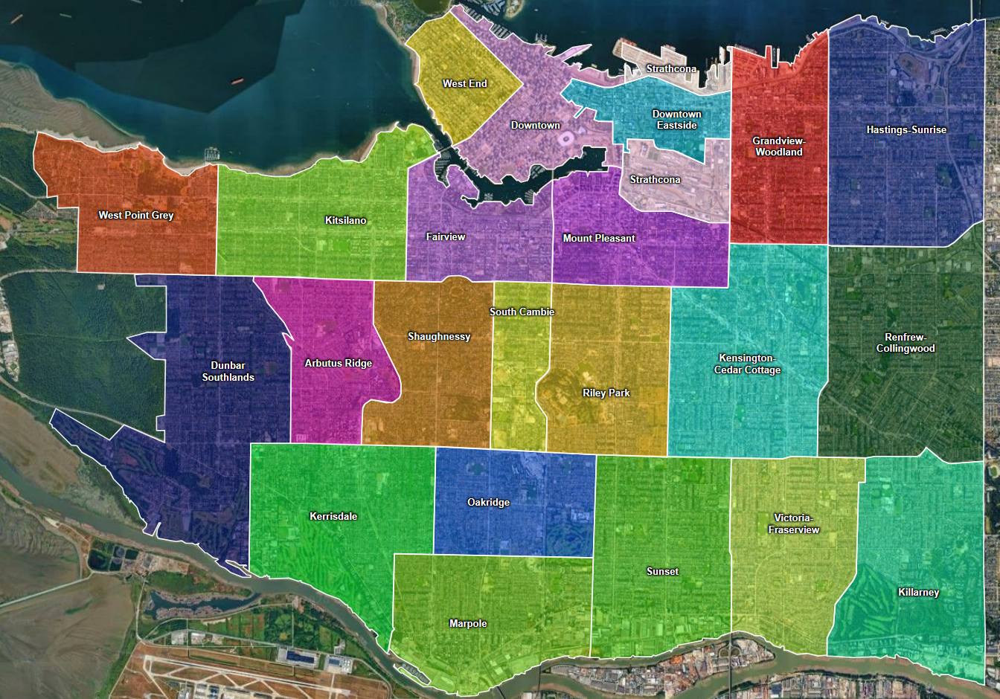

# DSSS-DataJam-2026

# Introduction
Data-Driven Developments (DDD), a fictional private real estate fund, will put $10M CAD into BC short-term rental property. Your team recommends where, how many properties and what mix, then defends it to DDD's investment committee.

# The Scenario
We are an analytics consultancy retained by DDD. The fund has a $10M CAD mandate to deploy into BC short-term rental property, with a stated preference for Metro Vancouver. The committee does not want a model. They want a decision, a number and a reason to believe us.

| Item | Detail |
| :--- : :---: |
| Client | Data-Driven Developments (DDD), a fictional private real estate fund |
| Mandate|Deploy $10M CAD into BC short-term rental property|
| Stated preference |Metro Vancouver|
| Properties operational|January 1, 2027|
| Performance measured|January 1, 2028 (the full 2027 calendar year)|
| Your call|Where, how many properties, what type and mix|
| Central trade-off|Few high-value properties vs. many modest ones|
| Audience|DDD's investment committee (the judges)|

# The Vancouver Neighbourhoods



# Repository Structure

```
├── data/
│    └── input/
│    └── output/
├── models/
│    └── model2/
│          └── output/
│          └── cleaning.py              # A shorter path for cleaning. A clone of the root directory one.
│          └── investment_roi.ipynb     # The fun stuff happens here
├── src/
│    ├── output/
│    ├── supplementary_data/ 
│    │     ├── output/
│    │     ├── cs_housing_market_info.py
│    │     ├── cs_num_units_by_building_size.py
│    │     ├── cs_percentile_rents_small_centres.py
│    │     ├── cs_rent_quartiles.py
│    │     ├── cs_vacancy_rates.py
│    │     └── README.md
│    ├── map_neighbourhoods_CMHC.zones.py
│    └── merge_clean_suppementary_data.py
├── tests/
├── .env                                # Not shared
├── .gitignore
├── cleaning.py
├── main.py
├── map.png                             # Generated by map.py
├── map.py                              # Generates map.png -> requires google maps API
└── requirements.txt
```

# Running the Code
This project assumes the user has a Python environment installed.

## Clone the repository
```bash
git clone https://github.com/eMongoose/DSSS-DataJam-2026.git ; cd DSSS-DataJam-2026
```

## Install dependencies

```bash
    python -m pip install -r requirements.txt
```

## Run the main file and the cleaning file
```bash
python main.py ; python cleaning.py
```

## Run the investment_roi notebook
Running this notebook is REQUIRED in order to reproduce the data provided in the presentation.

The notebook is located in ``models/model2/investment_roi.ipynb``


# References and Acknowledgements

Data Retrieved from: [Inside Airbnb, Get the Data](https://insideairbnb.com/get-the-data/)
Inside Airbnb, Vancouver, 15 June 2026, CC BY 4.0.